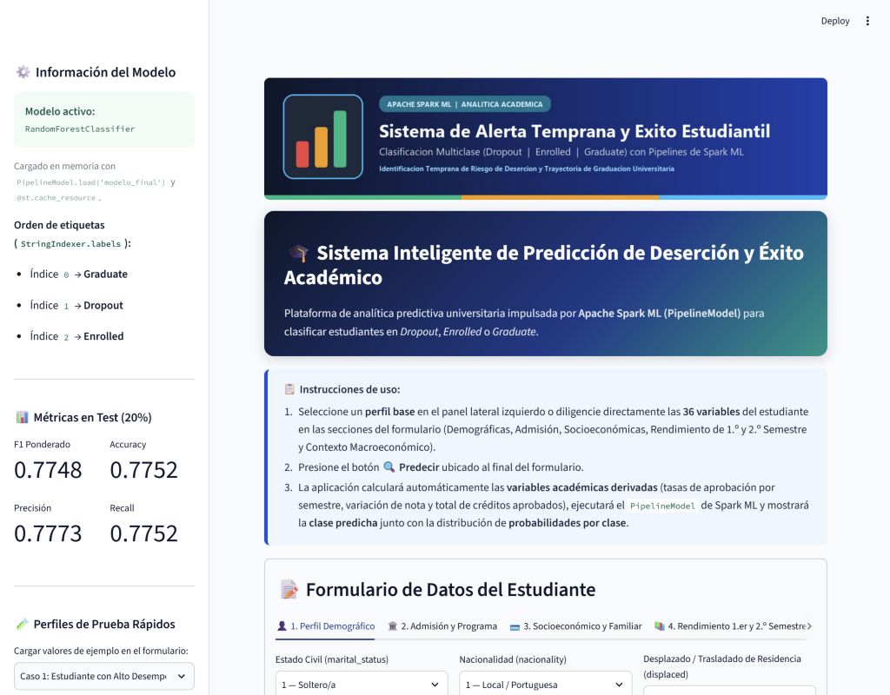
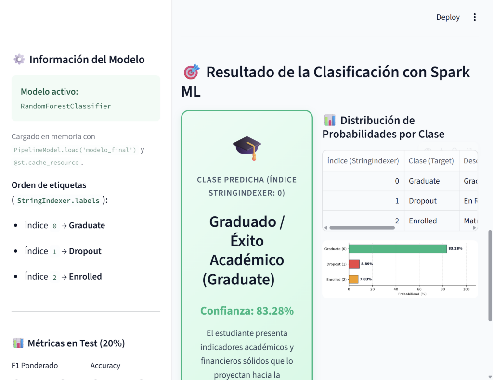

# 🎓 Predicción Temprana de Deserción y Éxito Académico Universitario con Apache Spark ML y Streamlit


**Autor:** Juan David Ortiz Pérez  
**Repositorio GitHub:** [https://github.com/J-Ortizz/parcial-bigdata-sparkml-dropout](https://github.com/J-Ortizz/parcial-bigdata-sparkml-dropout)  
**Despliegue en Streamlit Community Cloud:** `https://parcial-bigdata-sparkml-dropout.streamlit.app` *(Conectar el repositorio en [share.streamlit.io](https://share.streamlit.io) seleccionando `J-Ortizz/parcial-bigdata-sparkml-dropout`, rama `main`, archivo `app.py`)*

---

## 📌 Descripción del Proyecto
Este proyecto implementa una solución integral de **Big Data y Machine Learning con Apache Spark ML (`pyspark.ml`)** para ayudar a una institución universitaria a **identificar de forma temprana a los estudiantes en riesgo de deserción (`Dropout`)**, a quienes continúan matriculados en curso (`Enrolled`) y a quienes van camino de graduarse (`Graduate`).

El flujo de trabajo abarca desde la ingesta, limpieza, tratamiento del desbalance e ingeniería de características académicas en un notebook ejecutado (`Parcial_BigData_SparkML.ipynb`), hasta la construcción de **Pipelines completos con validación cruzada (`CrossValidator`, 3 folds)**, la exportación del mejor modelo (`modelo_final/` y `modelo_final.zip`) y su publicación en una **aplicación web interactiva con Streamlit (`app.py`)**.

---

## 🗂️ Estructura del Repositorio y Entregables

| Archivo / Carpeta | Descripción |
| :--- | :--- |
| [`Parcial_BigData_SparkML.ipynb`](Parcial_BigData_SparkML.ipynb) | Notebook ejecutado con salidas visibles, organizado en Secciones **A**, **B** y **C**, con celdas de texto explicativas antes de cada celda de código. |
| [`app.py`](app.py) | Aplicación web en Streamlit que carga `modelo_final` con `PipelineModel.load` y `@st.cache_resource`, calcula las variables derivadas y predice clase + probabilidades. |
| [`modelo_final/`](modelo_final) | Carpeta con el `PipelineModel` completo ganador (`RandomForestClassifier`) exportado por Spark ML + `labels.json`. |
| [`modelo_final.zip`](modelo_final.zip) | Archivo comprimido con la carpeta `modelo_final` completa. |
| [`data.csv`](data.csv) | Dataset *Predict Students' Dropout and Academic Success* (4.424 estudiantes, 37 columnas, separador `;`). |
| [`banner.png`](banner.png) | Imagen / banner institucional desplegado en el encabezado de la aplicación. |
| [`requirements.txt`](requirements.txt) | Dependencias de Python (`streamlit`, `pyspark==3.5.9`, `pandas`, `matplotlib`, `setuptools`). |
| [`packages.txt`](packages.txt) | Dependencia del sistema operativo (`default-jre`) para ejecutar la JVM de Apache Spark en Streamlit Community Cloud. |
| [`captura_formulario.png`](captura_formulario.png) | Captura de pantalla de la aplicación mostrando el banner, instrucciones y formulario. |
| [`captura_resultado.png`](captura_resultado.png) | Captura de pantalla de la aplicación mostrando la clase predicha y las probabilidades por clase. |

---

## 🧪 Resumen Metodológico y Resultados en el Conjunto de Prueba (20 %)

1. **Análisis del Desbalance (`Target`):**
   - `Graduate` (Índice `0`): **2.209 estudiantes (49,93 %)** — Clase dominante.
   - `Dropout` (Índice `1`): **1.421 estudiantes (32,12 %)** — Clase intermedia (riesgo crítico).
   - `Enrolled` (Índice `2`): **794 estudiantes (17,95 %)** — Clase minoritaria.
   - **Estrategia aplicada:** Ponderación inversa por frecuencia de clase (`weightCol="class_weight"`) calculada sobre entrenamiento ($w_c = N / (K \cdot N_c)$) combinada con evaluación mediante **F1 Ponderado**.

2. **Variables Académicas Derivadas (Tarea 3):**
   - `approval_rate_1st_sem`: Tasa de aprobación del 1.er semestre (controlando división por cero).
   - `approval_rate_2nd_sem`: Tasa de aprobación del 2.º semestre (controlando división por cero).
   - `grade_diff_sem`: Variación de la nota promedio entre el 2.º y el 1.er semestre.
   - `total_approved_units`: Total acumulado de unidades curriculares aprobadas en el primer año.

3. **Comparación de Modelos en el Conjunto de Prueba (`test_df`):**

| Modelo | Mejores Hiperparámetros (`CrossValidator` 3-Fold) | F1 CV (Train) | Accuracy (Test) | F1 Ponderado (Test) | Precisión Ponderada (Test) | Recall Ponderado (Test) |
| :--- | :--- | :---: | :---: | :---: | :---: | :---: |
| **`RandomForestClassifier` (Ganador)** | `numTrees=50, maxDepth=12` | **0.7684** | **0.7752** | **0.7748** | **0.7773** | **0.7752** |
| `LogisticRegression (Multinomial)` | `regParam=0.01, elasticNetParam=0.5` | 0.7608 | 0.7388 | 0.7439 | 0.7546 | 0.7388 |
| `DecisionTreeClassifier` | `maxDepth=5, minInstancesPerNode=5` | 0.7395 | 0.6962 | 0.7182 | 0.7708 | 0.6962 |

---

## 🖼️ Capturas de Pantalla de la Aplicación Funcionando

### 1. Vista del Encabezado, Instrucciones y Formulario (`st.form`)


### 2. Resultado de Clasificación y Probabilidades por Clase


---

## 🚀 Cómo Ejecutar la Aplicación

### Ejecución Local
1. Asegúrese de contar con **Java (JRE/JDK 8, 11 o 17)** y **Python 3.9+**.
2. Clone el repositorio e instale las dependencias:
   ```bash
   git clone https://github.com/J-Ortizz/parcial-bigdata-sparkml-dropout.git
   cd parcial-bigdata-sparkml-dropout
   pip install -r requirements.txt
   ```
3. Inicie la aplicación con Streamlit:
   ```bash
   streamlit run app.py
   ```

### Despliegue en Streamlit Community Cloud
1. Ingrese a [https://share.streamlit.io](https://share.streamlit.io) con su cuenta de GitHub (`J-Ortizz`).
2. Haga clic en **Create app** → Seleccione el repositorio `J-Ortizz/parcial-bigdata-sparkml-dropout`, rama `main` y archivo principal `app.py`.
3. Streamlit Cloud instalará automáticamente Java (`default-jre` desde `packages.txt`) y PySpark (`requirements.txt`), publicando la aplicación en la URL pública.
